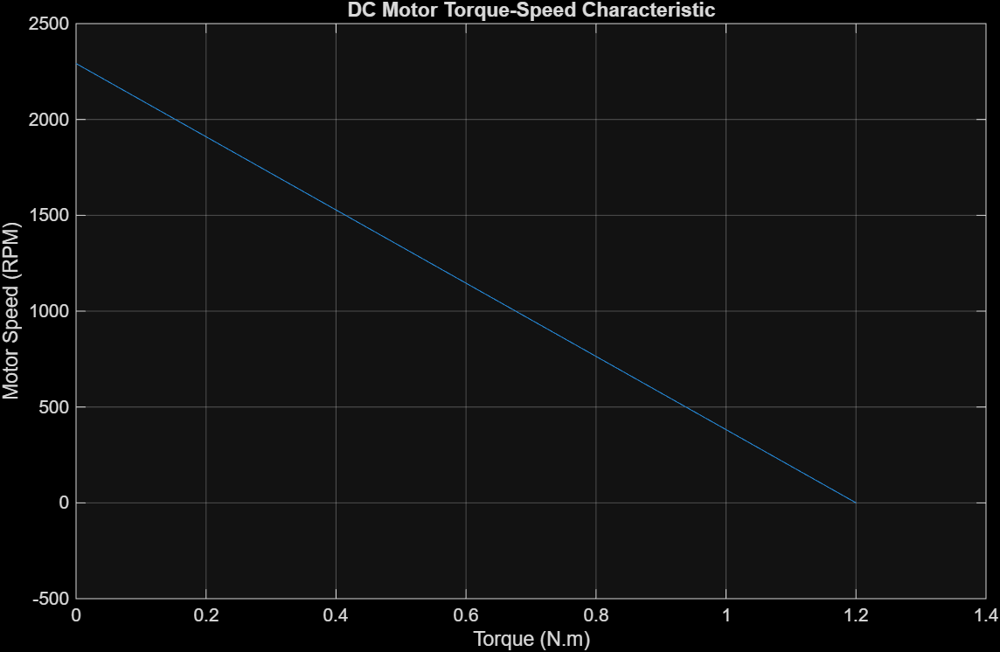
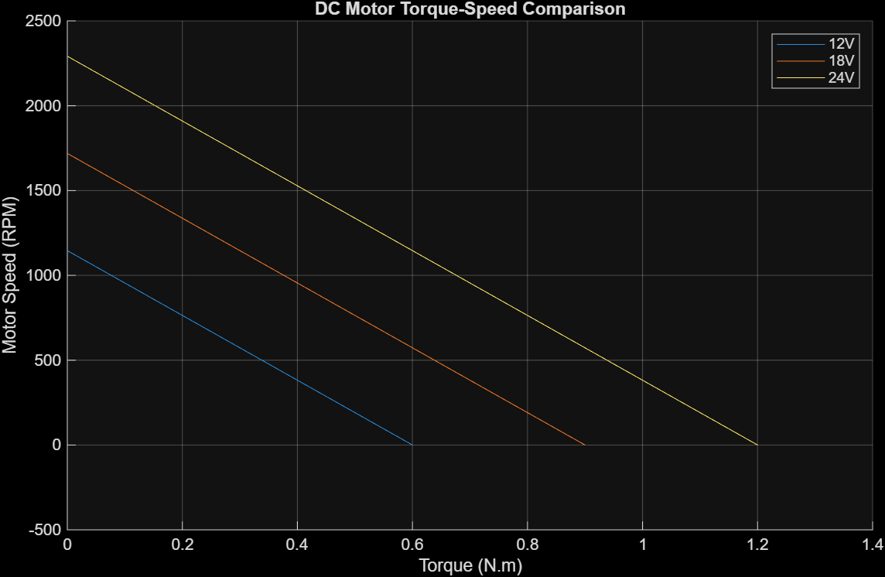
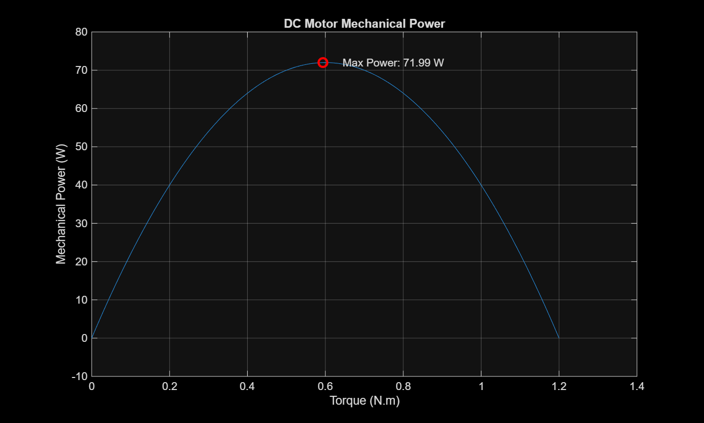

# DC Motor Performance Analysis Using MATLAB

## Project Overview

This project analyzes the steady-state performance of an ideal permanent-magnet DC motor using MATLAB.

The objective is to investigate the relationships between motor speed, torque, supply voltage, and mechanical output power.

## Project Features

- Torque-speed characteristic analysis
- Motor performance comparison at 12 V, 18 V, and 24 V
- Mechanical output power calculation
- Identification of the maximum power operating point
- Visualization of motor characteristics using MATLAB

## Motor Parameters

| Parameter | Value |
|---|---|
| Supply Voltage | 24 V |
| Armature Resistance | 2 Ohm |
| Back-EMF Constant | 0.1 V·s/rad |
| Torque Constant | 0.1 N·m/A |

## Mathematical Model

The analysis is based on the following steady-state DC motor equations:

**Voltage Equation:**

`V = R * I + Ke * omega`

**Torque Equation:**

`T = Kt * I`

**Motor Speed:**

`omega = (V - R * (T / Kt)) / Ke`

**Mechanical Output Power:**

`P = T * omega`

The model assumes constant motor parameters and neglects friction, windage, and other mechanical losses.

## Simulation Results

| Parameter | Result |
|---|---|
| Supply Voltage | 24 V |
| No-load Speed | 2292 RPM |
| Stall Torque | 1.20 N·m |
| Maximum Mechanical Power | 71.99 W |
| Torque at Maximum Power | 0.59 N·m |
| Speed at Maximum Power | 1157 RPM |

The maximum mechanical power occurs at approximately half the stall torque and half the no-load speed, consistent with the ideal DC motor model.

## Graphical Results

### 1. Torque-Speed Characteristic


This graph illustrates the linear decrease in motor speed as the load torque increases.

### 2. Supply Voltage Comparison


This graph compares the torque-speed characteristics at 12 V, 18 V, and 24 V. Increasing the supply voltage increases both the no-load speed and stall torque.

### 3. Mechanical Power Analysis


This graph shows the relationship between torque and mechanical output power, including the maximum power operating point.

## Technologies and Skills

- MATLAB programming
- DC motor mathematical modeling
- Electrical engineering fundamentals
- Numerical analysis
- Engineering data visualization

## Project Structure

```text
DC_Motor_Analysis/
|-- dc_motor_analysis.m
|-- torque_speed.png
|-- voltage_comparison.png
|-- mechanical_power.png
|-- README.md
```

## How to Run

1. Open MATLAB.
2. Open the file `dc_motor_analysis.m`.
3. Run the script.
4. Review the generated graphs and the numerical results in the Command Window.

## Future Improvements

- Include mechanical friction and electrical losses
- Analyze motor efficiency under different loads
- Investigate transient motor response
- Develop a Simulink model

## Conclusion

This project demonstrates the fundamental steady-state behavior of a DC motor and provides a foundation for further studies in electric machines, motor control, and industrial automation.

## Results and Visualizations

### Torque-Speed Characteristic


### Voltage Comparison


### Mechanical Power Analysis



Author
Yağmur Baltacı
